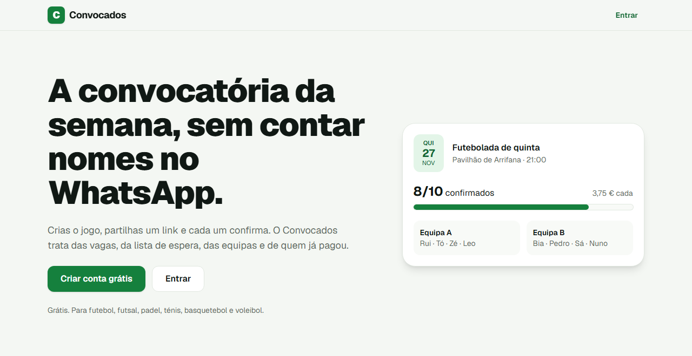
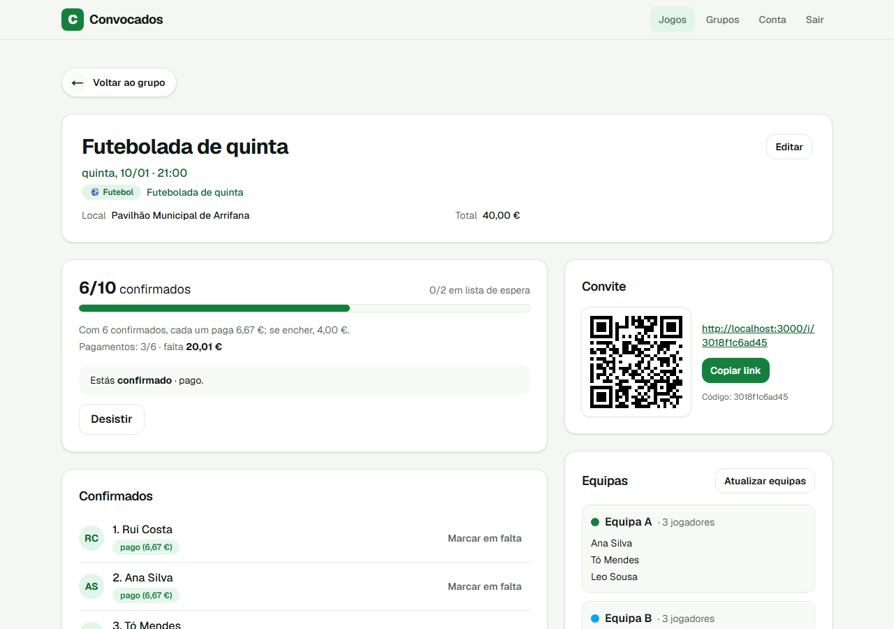
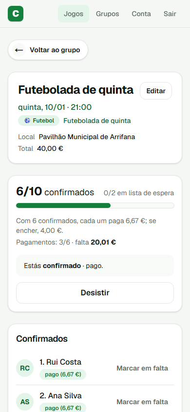

# Convocados

**English** · [Português](README.pt.md)

Organise weekly pickup games with your group: football, futsal, padel, tennis, basketball and volleyball.
Create a game, share one link, and everyone confirms. Convocados handles the slots, the waiting list, balanced
teams and who has paid.

**Live demo:** [convocados-web.onrender.com](https://convocados-web.onrender.com)
(free hosting: the first request after a while can take about a minute while the server wakes up)

<p>
  
</p>

<p>
  
  
</p>

## What it does

- **Invite by link or QR code.** The link opens the web app, so people without the app can still join.
- **Confirm and leave, with an automatic waiting list.** When someone leaves, the first person waiting moves up
  and gets a notification.
- **Live updates.** Every open screen shows the same list as soon as someone confirms or leaves.
- **Balanced teams in one click.** Players rate each other from 1 to 5 in private; teams always have the same
  size (at most one player apart) and the closest possible strength.
- **Payments.** The pitch cost is split between the confirmed players; the organiser marks who paid and sees
  what is missing.
- **Groups.** A group is the same people every week. Games in a group show up for every member, and a new game
  notifies them all.
- **Reminders and notifications** on Android (push for events, local notifications for reminders before the game).
- **Venue search** from OpenStreetMap data, or type the place by hand.
- **Paste the WhatsApp message** ("Thursday 9pm at the sports hall, 10 of us, 30€") and the form fills itself.
  If the AI is unavailable, the normal form is always there.
- **Account basics:** password reset by email, delete account, privacy page.

Android app via Expo; iPhone users use the web app (no App Store fee).

## Technical highlights

- **No overbooking under concurrency.** Confirming locks the game row (`SELECT … FOR UPDATE`) inside a
  transaction, counts the confirmed players and decides between "confirmed" and "waiting". An end-to-end test
  fires 20 confirmations in parallel against a real Postgres and checks that the slots are never exceeded.
- **Waiting list order is preserved** after people leave (position is `MAX(position) + 1`, not a count), with
  a regression test.
- **Same-site cookies across two domains.** The web and the API run on different Render domains, so the web
  talks to the API through its own `/api/*` proxy and the session cookie stays first-party. The real-time socket
  connects directly with a short-lived signed token.
- **Rate limits per person behind the proxy.** Login and registration allow 10 attempts per minute per IP; the
  proxy forwards the client IP with a shared secret, so a spoofed header cannot bypass the limit.
- **Reminders as local notifications.** The free API host sleeps, so a server cron could miss the time;
  reminders are scheduled on the phone and rescheduled when the app opens. Server push is only for events.
- **AI that cannot break the app.** The pasted message goes to Groq with a Zod schema; each field is validated
  on its own, with a daily quota of 10 requests per user, a 15-second timeout and a manual form as fallback.
- **Tested in CI on every push:** lint, typecheck, unit and component tests (shared, API, web, mobile),
  API end-to-end tests against Postgres, a migrations-vs-entities check, and browser tests with Playwright
  running the web and the API on different sites, like production.

## Stack

| Part | Technology |
|---|---|
| Mobile | Expo, React Native, Expo Router, Expo Notifications |
| Web | Next.js 16, React 19, Tailwind CSS 4 |
| API and real time | NestJS, Socket.IO, TypeORM |
| Database | PostgreSQL |
| Shared | TypeScript types and Zod schemas (`packages/shared`), entities (`packages/db`) |
| AI | Groq (`llama-3.3-70b-versatile`) |
| Email | Resend |
| Monorepo and CI | pnpm, Turborepo, GitHub Actions |
| Tests | Vitest, Jest (mobile), Supertest, Playwright |
| Hosting | Render (web, API and Postgres) |

```
convocados/
├── apps/
│   ├── api/        NestJS API: REST, Socket.IO, AI, push
│   ├── web/        Next.js web app (invites, iPhone users)
│   └── mobile/     Expo app (Android and iOS)
├── packages/
│   ├── shared/     types, Zod schemas and shared logic (prices, sports)
│   └── db/         TypeORM entities
└── docker-compose.yml   local PostgreSQL
```

The web and the mobile app never talk to the database or the AI directly: everything goes through the API,
and the keys stay on the server.

## Run it locally

Requirements: Node.js 22+, pnpm 12, Docker.

```bash
pnpm install
cp .env.example .env                       # API settings (database, ports)
cp apps/web/.env.example apps/web/.env.local
cp apps/mobile/.env.example apps/mobile/.env   # use your computer's local IP, not localhost
pnpm db:up                                 # PostgreSQL on port 5435
pnpm dev                                   # API on :3001 and web on :3000 (migrations run on start)
```

Mobile (Expo Go or a development build), in another terminal:

```bash
pnpm mobile
```

Optional: `GROQ_API_KEY` in `.env` enables the "paste a message" feature, `RESEND_API_KEY` sends password
reset emails (without it, the link is printed in the API log), and
`pnpm --filter api venues:import` loads venues from OpenStreetMap for an area.

## Tests

```bash
pnpm lint && pnpm typecheck
pnpm test             # unit and component tests
pnpm test:e2e         # API end-to-end tests (needs pnpm db:up)
pnpm test:browser     # Playwright: web + API + Postgres
```

## Status

The web app and the API are online and in use. Next: the Android APK on GitHub Releases and a few weeks of
use with a real group.

Venue data © [OpenStreetMap contributors](https://www.openstreetmap.org/copyright).
