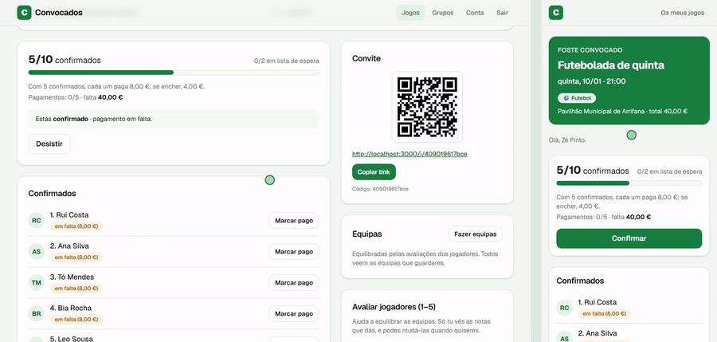
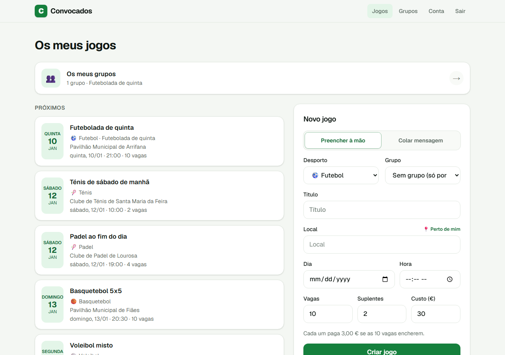
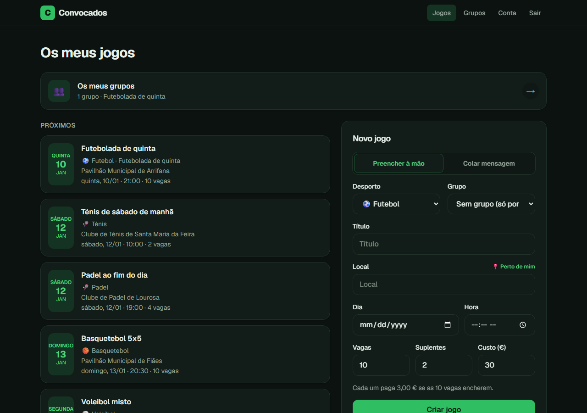
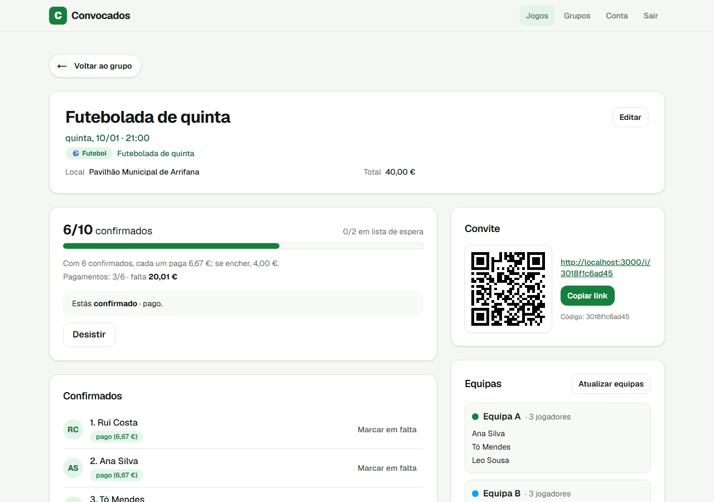
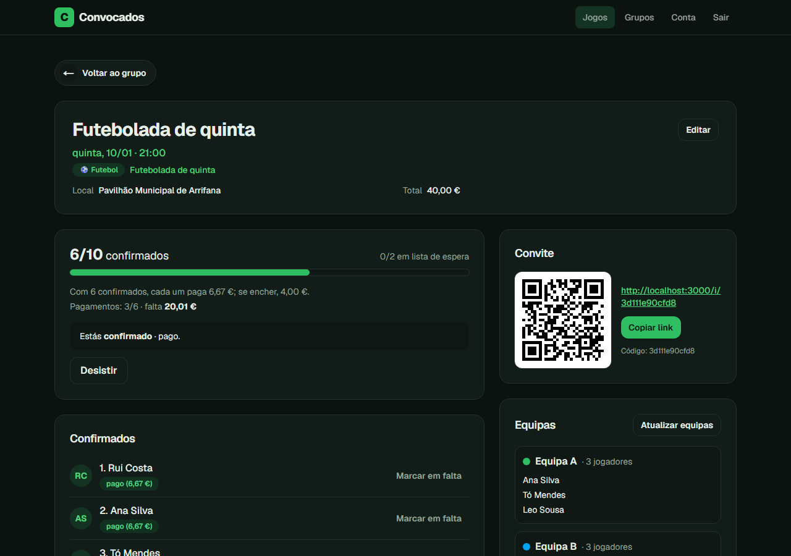
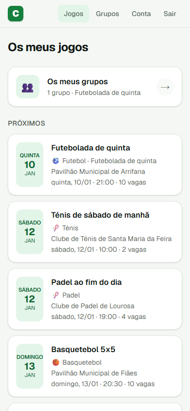
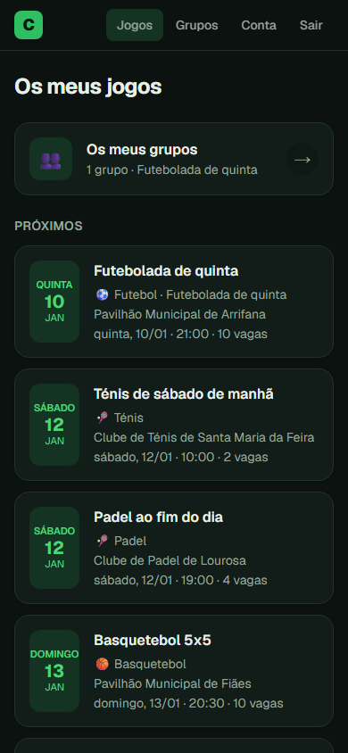
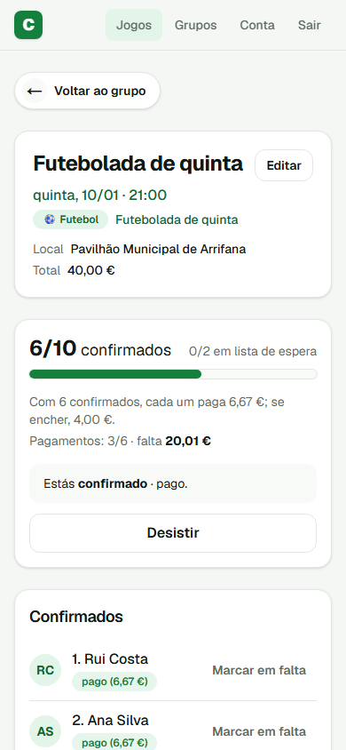
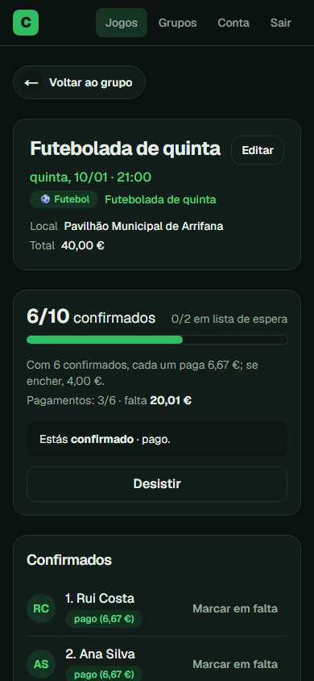
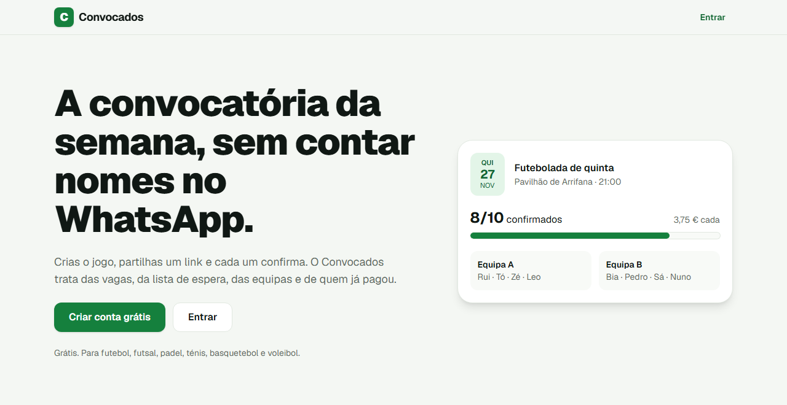

# Convocados

[English](README.md) · **Português**

Organiza os jogos da semana com o teu grupo: futebol, futsal, padel, ténis, basquetebol e voleibol.
Crias o jogo, partilhas um link e cada um confirma. O Convocados trata das vagas, da lista de espera, das
equipas equilibradas e de quem já pagou.

[](https://github.com/PedroPinho17/convocados/actions/workflows/ci.yml)


<p align="center">
  
</p>
<p align="center"><sub>Um jogo de padel: organizador no computador (esquerda) e jogador no telemóvel (direita), em tempo real ·
<a href="docs/media/demo.mp4">vídeo em melhor qualidade (.mp4)</a> · todos os nomes são fictícios</sub></p>

## Experimenta

**[convocados-web.onrender.com](https://convocados-web.onrender.com)**

**[Descarregar para Android](https://github.com/PedroPinho17/convocados/releases/latest/download/convocados-1.0.0.apk)** (Android 8+; no iPhone usa a versão web)

1. Cria uma conta e um jogo.
2. Abre o link de convite do jogo noutro browser (ou no telemóvel) e confirma com uma segunda conta.
3. Repara nos dois ecrãs: a lista, as equipas e os pagamentos atualizam sem recarregar a página.

API: [convocados-api.onrender.com/health](https://convocados-api.onrender.com/health).
Os dois estão no plano gratuito do Render, por isso o primeiro pedido depois de algum tempo parado pode demorar
cerca de um minuto, enquanto os servidores acordam.

## Screenshots

| Claro | Escuro |
|---|---|
|  |  |
|  |  |
|  |  |
|  |  |



## O que faz

- **Convite por link ou QR code.** O link abre a versão web, por isso quem não tem a app também entra.
- **Confirmar e desistir, com lista de espera automática.** Quando alguém desiste, o primeiro da fila entra e
  recebe uma notificação.
- **Atualizações em tempo real.** Todos os ecrãs abertos mostram a mesma lista assim que alguém confirma ou
  desiste.
- **Equipas equilibradas num clique.** Os jogadores avaliam-se de 1 a 5, em privado; as equipas têm sempre o
  mesmo tamanho (no máximo um jogador de diferença) e a força mais parecida possível.
- **Pagamentos.** O custo do campo é dividido pelos confirmados; o organizador marca quem pagou e vê quanto falta.
- **Grupos.** Um grupo são as mesmas pessoas de todas as semanas. Os jogos do grupo aparecem a todos os membros,
  e cada jogo novo avisa toda a gente.
- **Lembretes e notificações** no Android (push para eventos, notificações locais para os lembretes antes do jogo).
- **Pesquisa de campos** a partir do OpenStreetMap, ou o local escrito à mão.
- **Colar a mensagem do WhatsApp** ("quinta às 21h no pavilhão, somos 10, 30€") e o formulário fica preenchido.
  Se a IA não estiver disponível, o formulário normal está sempre lá.
- **O básico da conta:** recuperar a password por email, apagar a conta e página de privacidade.

App Android com Expo; quem usa iPhone entra pela versão web (sem a taxa da App Store).

## Destaques técnicos

- **Sem vagas a mais, mesmo com pedidos em simultâneo.** Confirmar tranca a linha do jogo (`SELECT … FOR UPDATE`)
  dentro de uma transação, conta os confirmados e decide entre "confirmado" e "em espera". Um teste de ponta a
  ponta dispara 20 confirmações em paralelo contra um Postgres real e verifica que as vagas nunca são excedidas.
- **A lista de espera mantém a ordem de chegada** depois de desistências (a posição é `MAX(position) + 1`, não
  uma contagem), com um teste de regressão.
- **Cookies no mesmo site com dois domínios.** A web e a API estão em domínios diferentes do Render, por isso a
  web fala com a API por um proxy próprio em `/api/*` e o cookie da sessão fica no site da web. O socket do tempo
  real liga direto à API com um token curto e assinado.
- **Limite de tentativas por pessoa, mesmo atrás do proxy.** Login e registo aceitam 10 tentativas por minuto
  por IP; o proxy envia o IP de quem pede com um segredo partilhado, por isso um cabeçalho falsificado não fura
  o limite.
- **Lembretes como notificações locais.** O alojamento gratuito da API adormece e um cron no servidor podia
  falhar a hora; os lembretes são agendados no telemóvel e voltam a ser agendados ao abrir a app. O push do
  servidor fica só para eventos.
- **IA que não estraga a app.** A mensagem colada vai ao Groq com um schema Zod; cada campo é validado sozinho,
  com uma quota de 10 pedidos por dia por utilizador, timeout de 15 segundos e o formulário manual como recurso.
- **Testado no CI em cada push:** lint, typecheck, testes unitários e de componentes (shared, API, web, mobile),
  testes de ponta a ponta da API com Postgres, verificação de que as migrações batem certo com as entidades, e
  testes no browser com Playwright, com a web e a API em sites diferentes, como em produção.

## Stack

| Parte | Tecnologia |
|---|---|
| Mobile | Expo, React Native, Expo Router, Expo Notifications |
| Web | Next.js 16, React 19, Tailwind CSS 4 |
| API e tempo real | NestJS, Socket.IO, TypeORM |
| Base de dados | PostgreSQL |
| Partilhado | Tipos TypeScript e schemas Zod (`packages/shared`), entidades (`packages/db`) |
| IA | Groq (`llama-3.3-70b-versatile`) |
| Email | Resend |
| Monorepo e CI | pnpm, Turborepo, GitHub Actions |
| Testes | Vitest, Jest (mobile), Supertest, Playwright |
| Alojamento | Render (web, API e Postgres) |

```
convocados/
├── apps/
│   ├── api/        API NestJS: REST, Socket.IO, IA, push
│   ├── web/        Web Next.js (convites, quem usa iPhone)
│   └── mobile/     App Expo (Android e iOS)
├── packages/
│   ├── shared/     tipos, schemas Zod e lógica partilhada (preços, desportos)
│   └── db/         entidades TypeORM
└── docker-compose.yml   PostgreSQL local
```

A web e a app nunca falam diretamente com a base de dados nem com a IA: passa tudo pela API, e as chaves ficam
no servidor.

## Correr localmente

Precisas de Node.js 22+, pnpm 12 e Docker.

```bash
pnpm install
cp .env.example .env                       # configuração da API (base de dados, portas)
cp apps/web/.env.example apps/web/.env.local
cp apps/mobile/.env.example apps/mobile/.env   # usa o IP do computador na rede local, não localhost
pnpm db:up                                 # PostgreSQL na porta 5435
pnpm dev                                   # API em :3001 e web em :3000 (as migrações correm ao arrancar)
```

Mobile (Expo Go ou uma development build), noutro terminal:

```bash
pnpm mobile
```

Opcional: `GROQ_API_KEY` no `.env` liga o "colar mensagem", `RESEND_API_KEY` envia os emails de recuperação da
password (sem ela, o link aparece no log da API), e `pnpm --filter api venues:import` carrega os campos do
OpenStreetMap de uma zona.

## Testes

```bash
pnpm lint && pnpm typecheck
pnpm test             # testes unitários e de componentes
pnpm test:e2e         # testes de ponta a ponta da API (precisa de pnpm db:up)
pnpm test:browser     # Playwright: web + API + Postgres
```

## Estado

A web e a API estão online e em uso. A seguir: o APK Android nas GitHub Releases e algumas semanas de uso com um
grupo real.

Dados dos campos © [contribuidores do OpenStreetMap](https://www.openstreetmap.org/copyright).
